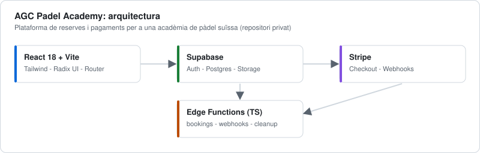
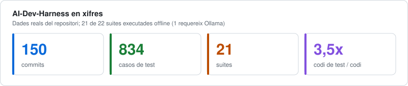
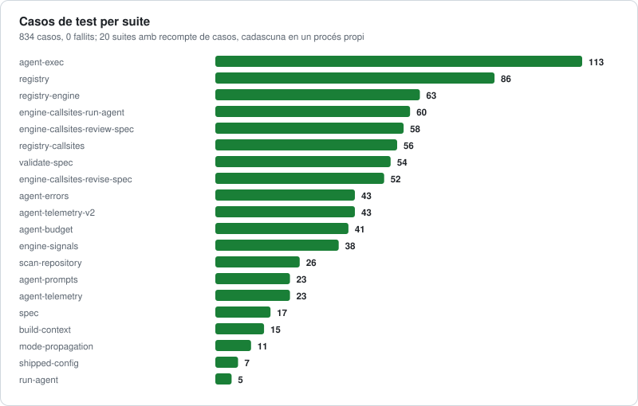
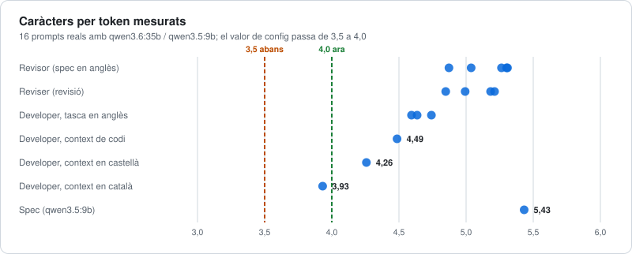
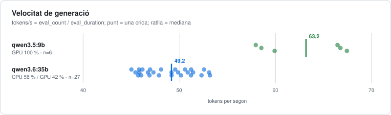
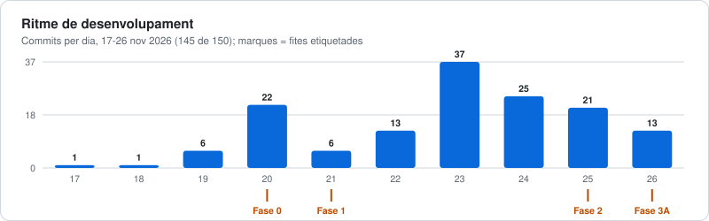
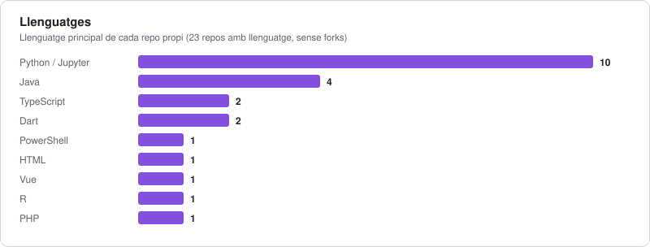

🌐 [English](README.md) · **Català** · [Español](README.es.md)

# Hola, sóc Joan!

Desenvolupador full-stack i enginyer de sistemes d'IA de **Barcelona**, amb experiència professional des del 2022 construint plataformes web i sistemes de backend (Laravel, Vue, React, Go, AWS) i una especialització en **IA i Big Data**. M'interessa especialment la **IA aplicada al desenvolupament de programari**: agents, models locals, desenvolupament dirigit per especificacions i, sobretot, **mesurar** què funciona de veritat.

> 🟢 **Obert a oportunitats:** rols de Full-Stack Developer · Barcelona (híbrid) o en remot.

## 🎯 Què puc aportar

- **Lliurament de punta a punta:** porto els productes dels requisits a producció. AGC Padel Academy (reserves i pagaments amb Stripe) és en directe amb usuaris reals (unes 50 reserves al mes).
- **Integracions i dades:** vaig liderar la migració d'una aplicació de base de dades local a l'ERP d'una empresa, i he treballat com a administrador de bases de dades en sistemes multinacionals.
- **IA mesurada, no suposada:** sistemes d'agents amb LLMs locals, amb 834 tests offline i benchmarks sobre prompts reals.

## 💼 Experiència

| Període | Rol | Què he fet |
|---|---|---|
| Des 2024 – Oct 2026 | **Enginyer de programari Full-Stack**, NessunDorma Group | Aplicacions web i API REST amb PHP, Laravel, Vue.js, TypeScript i Go; vaig liderar la migració d'una aplicació de base de dades local a l'ERP de l'empresa; plataforma interna d'automatització de presentacions en temps real (sincronització, PDF, QR) i eines de registre i automatització en Go. |
| Oct 2025 – avui | **Freelance**: AGC Padel Academy | Plataforma de reserves i pagaments en producció per a una acadèmia esportiva a Suïssa (React, Supabase, Stripe), amb unes 50 reserves al mes. |
| Oct 2023 – Mar 2024 | **Administrador de bases de dades**, Rehau S.A. | Manteniment de bases de dades multinacionals (Espanya / Portugal), permisos d'usuari i dades d'ERP. |
| Gen 2022 – Jun 2023 | **Desenvolupador multiplataforma**, Dokuos | Programari interactiu per a tòtems digitals (Node.js, PHP, Flutter, Dart, MySQL), manteniment remot de programari i gestió de backend i bases de dades. |
| Feb – Jul 2019 | **Tècnic informàtic**, InfoConnexions | Instal·lació i manteniment de sistemes, aplicacions i maquinari. |

**Educació:** Curs d'especialització en IA i Big Data (2024–2025) · CFGS en Desenvolupament d'Aplicacions Multiplataforma, DAM (2020–2022) · CFGM en Sistemes Microinformàtics i Xarxes (2017–2019)

**Certificats:** AWS Academy (Fonaments del núvol, Arquitectura del núvol, Enginyeria de dades) · Hugging Face, curs d'agents

**Idiomes:** català (nadiu) · castellà (nadiu) · anglès (nivell professional)

---

## 🚀 En producció: AGC Padel Academy

**Plataforma de reserves i pagaments** full-stack per a [AGC Padel Academy](https://agcpadelacademy.com), una acadèmia de pàdel a Suïssa. Construïda **de principi a final com a MVP** (requisits, model de dades, frontend, backend, pagaments i desplegament) i **en producció amb clients reals** (unes 50 reserves al mes).

> 🔒 El codi font és privat (feina per a un client). Estaré encantat d'explicar l'arquitectura i el codi si ho voleu.

**Què fa**

- Web pública: classes, viatges, torneigs, contacte i condicions legals, totalment responsive
- Reserva de classes i activitats, amb comptes d'usuari (login i gestió del perfil)
- Pagaments en línia amb **Stripe Checkout**, confirmats al servidor mitjançant **webhooks**
- Regles de reserva a la capa de dades: terminis de cancel·lació, neteja de reserves sense pagar i crèdits de classes
- Panell d'administració perquè entrenadors i equip gestionin sessions, disponibilitat i reserves
- Lògica de servidor amb **Supabase Edge Functions** (TypeScript): reserves, webhooks, neteja i formulari de contacte

**Stack:** React 18 · Vite · Tailwind CSS · Radix UI · React Router · Supabase (Auth, Postgres, Storage, Edge Functions) · Stripe

---

## 🧰 Tecnologies i què n'he fet

Resum extret del codi dels meus repositoris (públics i privats). Els projectes privats es descriuen només per tecnologia.

| Àrea | Tecnologies | Per a què les he aplicat |
|---|---|---|
| **🤖 Agents d'IA i LLMs** | Ollama · Qwen 3.5/3.6 · Claude · LangChain · LangGraph · MCP · Hugging Face | Harness multiagent dirigit per especificacions amb pressupost de tokens, telemetria i benchmarks de models; un chatbot multiagent (Flask + LangGraph + Vue) que analitza i instal·la repositoris de GitHub; experiments amb un servidor MCP local. |
| **🧠 Deep learning i NLP** | PyTorch · torchvision · Transformers · Pinecone | Implementació pròpia de xarxes neuronals, classificació d'imatges (dataset de melanoma), models tabulars, LSTM, Transformers i GPT-2, i un pipeline RAG amb base de dades vectorial. |
| **📈 ML clàssic i RL** | scikit-learn · pandas · NumPy · seaborn · Gymnasium · R | Classificació sobre datasets d'Iris, vi i malaltia cardíaca, cerca en laberints (A*), scripts d'estadística en R i un agent DQN (replay buffer, epsilon-greedy) sobre CartPole escrit mòdul a mòdul. |
| **👁️ Visió i àudio** | OpenCV · Ultralytics YOLO · Supervision · wav2vec | Detecció d'objectes i supervisió sobre vídeo, i exploració d'àudio de veu i vocals. |
| **🎨 Frontend** | React 18 · Vite · Tailwind CSS · Radix UI · Vue 3 · Nuxt 3 · Angular · TypeScript | Web de reserves en producció amb React; portfolio SSR ([josafe.dev](https://www.josafe.dev)) amb contingut tipat i i18n català/castellà/anglès; apps Vue 3 + TypeScript; Angular amb RxJS, rutes i tests Karma/Jasmine. |
| **⚙️ Backend i APIs** | Laravel 10/12/13 · Filament · PHP 8.3 · Supabase Edge Functions · Flask · Go · Sanctum | Panell d'administració amb accés per rols mitjançant policies i enums, amb tests PHPUnit; funcions serverless per a reserves i webhooks de Stripe; APIs REST amb Flask i Laravel; serveis en Go en projectes privats. |
| **🗄️ Dades i pagaments** | PostgreSQL · SQLite · SQL · JDBC · Stripe | Esquemes relacionals i migracions, Stripe Checkout confirmat per webhooks i accés a bases de dades des de Java. |
| **📱 Mòbil i escriptori** | Flutter/Dart · Kotlin · Java (Swing/AWT, concurrència, JUnit) · React Native | Dashboard d'administració en Flutter (provider, gràfics, calendari) sobre un backend PHP; apps Android en Kotlin; aplicacions d'escriptori en Java; prova tècnica de React Native + TypeScript. |
| **🚢 DevOps i eines** | Git/GitHub · Docker Compose · certbot · cron · AWS (S3, CloudFront, Route 53) · PowerShell | Tags per fase i worktrees; desplegament amb contenidors, HTTPS i tasques programades en projectes privats; hosting estàtic a AWS; automatització en PowerShell 5.1 i un runner de tests propi. |
| **🧪 Pràctiques d'enginyeria** | Desenvolupament dirigit per especificacions · tests golden i de mutació · telemetria · auditories · i18n | Especificacions revisades abans del codi, suites de test offline amb tripwire del repositori, calibratge mesurat dels pressupostos de models i informes d'auditoria escrits. |

---

## 🔭 Projecte destacat: [AI-Dev-Harness](https://github.com/Josafe/AI-Dev-Harness)

Entorn multiagent i multimodel per al **desenvolupament dirigit per especificacions (SDD)**. Models locals (Qwen 3.5 / 3.6 amb Ollama) per a tasques senzilles i Claude com a orquestrador i revisor segons la dificultat. Tot el treball passa per un cicle **spec → revisió → revisió de l'spec → implementació**, amb aprovació humana a cada pas.

<b>Arquitectura, tests i benchmarks d'AI-Dev-Harness</b>

**Què hi ha dins**

| Peça | Què fa |
|---|---|
| `scripts/specify.ps1`, `review-spec.ps1`, `revise-spec.ps1` | Flux SDD amb agents especialitzats (spec, reviewer, reviser, developer) |
| `scripts/run-agent.ps1` | Executa qualsevol agent definit a `.ai/agents/` sota un contracte comú |
| `scripts/validate-spec.ps1` | Validador d'especificacions (estructura i semàntica) |
| `scripts/build-context.ps1`, `scan-repository.ps1` | Context del repositori per als agents, amb pressupost de tokens |
| `scripts/lib/` | Motor compartit: registre de models/perfils, crides a Ollama, telemetria, reintents |
| `.ai/config.json` | Registre únic de models, perfils i límits (res hardcodejat als scripts) |

### 🧪 Tests

- 22 suites en **Windows PowerShell 5.1** (834 casos executats offline, 0 fallits), cadascuna en el seu propi procés, executades per `scripts/test-all.ps1`.
- El runner **falla qualsevol suite que modifiqui el repositori** (tripwire) i diferencia `PASS`, `PASS WITH SKIPS` i `FAIL`; els tests que necessiten un model real només s'executen amb `-IncludeLive`.
- Tests *golden* dels prompts, *mocks* d'Ollama (fake host per TCP local) i fixtures d'especificacions vàlides i invàlides.
- **Mutation testing** a mà: 20 mutants de la configuració, tots detectats pels tests (vegeu l'informe de calibratge).

> Execució del 26-11-2026 sense Ollama: 21 de 22 suites executades (una necessita un model real). El runner va marcar 2 suites com a FAIL només pel *tripwire*, perquè un altre worktree del projecte es modificava durant l'execució; els seus casos van passar tots.

### 📊 Benchmarks i validació de models

- `scripts/benchmark-models.ps1`: compara models amb N repeticions i en calcula la **mediana** (tokens/s = `eval_count / eval_duration`).
- Validació real de `qwen3.5:9b` i `qwen3.6:35b`: el revisor detecta una spec dolenta de manera consistent (2 de 2 execucions, ~52 s) i s'han documentat els límits de la mostra.
- **Calibratge del pressupost de context** amb 16 prompts reals: `charsPerToken` 3,5 → 4,0 i `reservedOutputTokens` 8192 → 6144, eliminant 7 de 10 falsos avisos de truncament.

> Mostres petites i una sola màquina: són senyals, no benchmarks definitius. El context en català (3,93 car./token) queda per sota del 4,0 configurat, i l'informe ho documenta.

### 🗓️ Ritme de desenvolupament

### 📚 Documentació de l'enginyeria

El projecte documenta cada fase amb informes d'auditoria independents, indicant què és *FACT*, *DECISION*, *ASSUMPTION* o *NOT VERIFIED*:

- [Roadmap de modernització](https://github.com/Josafe/AI-Dev-Harness/blob/master/docs/roadmap/modernization-roadmap.md)
- [Validació de models (ronda 2)](https://github.com/Josafe/AI-Dev-Harness/blob/master/docs/audits/2026-11-19-model-validation-2.md)
- [Calibratge de la fase 2](https://github.com/Josafe/AI-Dev-Harness/blob/master/docs/audits/2026-11-25-phase2-calibration.md)
- [QA final de la fase 2](https://github.com/Josafe/AI-Dev-Harness/blob/master/docs/audits/2026-11-26-phase2-final-qa.md)
- [Revisió de la porta de la fase 3A](https://github.com/Josafe/AI-Dev-Harness/blob/master/docs/audits/2026-11-26-phase3a-gate-review.md)

**Stack:** PowerShell 5.1 · Ollama · Qwen 3.5 / 3.6 · Claude · Git · Specification-Driven Development

---

## 🗂️ Altres projectes

| Projecte | Descripció | Stack |
|---|---|---|
| [SME-Management-Pilot](https://github.com/Josafe/SME-Management-Pilot) | Aplicació modular de gestió per a pimes de serveis | PHP |
| [Portfolio](https://github.com/Josafe/Portfolio) | Portfolio personal amb els projectes desenvolupats | Vue |
| [TFM-Sistema-Chatbot-Multiagent](https://github.com/Josafe/TFM-Sistema-Chatbot-Multiagent) | Chatbot lleuger reentrenat amb sistema multiagent per analitzar, clonar i instal·lar dependències de repositoris de GitHub | Python |
| [AI](https://github.com/Josafe/AI) | Tot el meu progrés en IA: ML clàssic, deep learning, NLP, imatge | Jupyter · Python |
| [TFG-CFGS-DAM](https://github.com/Josafe/TFG-CFGS-DAM) | Control remot de tòtems registrats a la BD | Dart |

## 📫 Contacte

📍 Barcelona, Catalunya · 🌐 [josafe.dev](https://www.josafe.dev) · 🔗 [LinkedIn](https://www.linkedin.com/in/joan-sabater-ferr%C3%A9-2b4169115/) · 💼 GitHub: [@Josafe](https://github.com/Josafe)
