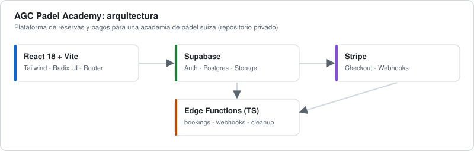
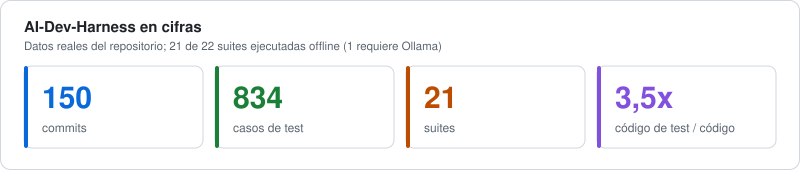
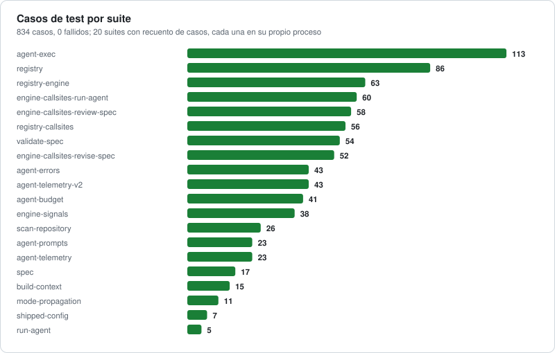
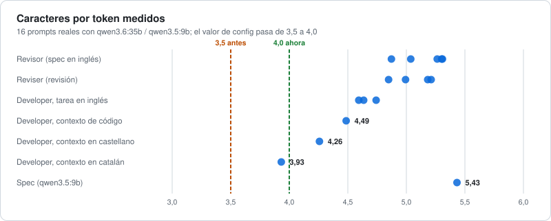
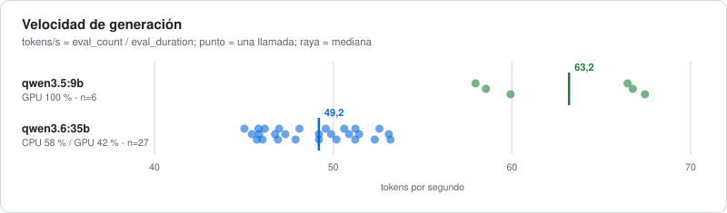
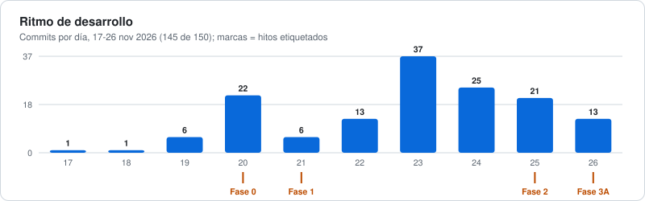
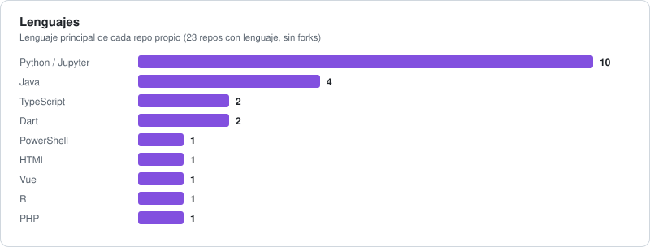

🌐 [English](README.md) · [Català](README.ca.md) · **Español**

# ¡Hola, soy Joan!

Desarrollador full-stack e ingeniero de sistemas de IA de **Barcelona**, con experiencia profesional desde 2022 construyendo plataformas web y sistemas backend (Laravel, Vue, React, Go, AWS) y una especialización en **IA y Big Data**. Me interesa especialmente la **IA aplicada al desarrollo de software**: agentes, modelos locales, desarrollo dirigido por especificaciones y, sobre todo, **medir** qué funciona de verdad.

> 🟢 **Abierto a oportunidades:** roles de Full-Stack Developer · Barcelona (híbrido) o en remoto.

## 🎯 Qué puedo aportar

- **Entrega de punta a punta:** llevo los productos de los requisitos a producción. AGC Padel Academy (reservas y pagos con Stripe) está en directo con usuarios reales.
- **Integraciones y datos:** lideré la migración de una aplicación de base de datos local al ERP de una empresa, y he trabajado como administrador de bases de datos en sistemas multinacionales.
- **IA medida, no supuesta:** sistemas de agentes con LLMs locales, con 834 tests offline y benchmarks sobre prompts reales.

## 💼 Experiencia

| Periodo | Rol | Qué hice |
|---|---|---|
| Dic 2024 – Oct 2026 | **Ingeniero de software Full-Stack**, NessunDorma Group | Aplicaciones web y API REST con PHP, Laravel, Vue.js, TypeScript y Go; lideré la migración de una aplicación de base de datos local al ERP de la empresa; plataforma interna de automatización de presentaciones en tiempo real (sincronización, PDF, QR) y herramientas de registro y automatización en Go. |
| Oct 2025 – hoy | **Freelance**: AGC Padel Academy | Plataforma de reservas y pagos en producción para una academia deportiva en Suiza (React, Supabase, Stripe). |
| Oct 2023 – Mar 2024 | **Administrador de bases de datos**, Rehau S.A. | Mantenimiento de bases de datos multinacionales (España / Portugal), permisos de usuario y datos del ERP. |
| Ene 2022 – Jun 2023 | **Desarrollador multiplataforma**, Dokuos | Software interactivo para tótems digitales (Node.js, PHP, Flutter, Dart, MySQL), mantenimiento remoto de software y gestión de backend y bases de datos. |
| Feb – Jul 2019 | **Técnico informático**, InfoConnexions | Instalación y mantenimiento de sistemas, aplicaciones y hardware. |

**Estudios:** Curso de especialización en IA y Big Data (2024–2025) · CFGS en Desarrollo de Aplicaciones Multiplataforma, DAM (2020–2022) · CFGM en Sistemas Microinformáticos y Redes (2017–2019)

**Certificaciones:** AWS Academy (Cloud Foundations, Cloud Architecting, Data Engineering) · Hugging Face, curso de agentes

---

## 🚀 En producción: AGC Padel Academy

**Plataforma de reservas y pagos** full-stack para [AGC Padel Academy](https://agcpadelacademy.com), una academia de pádel en Suiza. Construida **de principio a fin como MVP** (requisitos, modelo de datos, frontend, backend, pagos y despliegue) y **en producción con clientes reales**.

> 🔒 El código fuente es privado (trabajo para un cliente). Estaré encantado de explicar la arquitectura y el código si lo deseas.

**Qué hace**

- Web pública: clases, viajes, torneos, contacto y condiciones legales, totalmente responsive
- Reserva de clases y actividades, con cuentas de usuario (login y gestión del perfil)
- Pagos online con **Stripe Checkout**, confirmados en el servidor mediante **webhooks**
- Reglas de reserva en la capa de datos: plazos de cancelación, limpieza de reservas sin pagar y créditos de clases
- Panel de administración para que entrenadores y equipo gestionen sesiones, disponibilidad y reservas
- Lógica de servidor con **Supabase Edge Functions** (TypeScript): reservas, webhooks, limpieza y formulario de contacto

**Stack:** React 18 · Vite · Tailwind CSS · Radix UI · React Router · Supabase (Auth, Postgres, Storage, Edge Functions) · Stripe

---

## 🧰 Tecnologías y qué he hecho con ellas

Resumen extraído del código de mis repositorios (públicos y privados). Los proyectos privados se describen solo por tecnología.

| Área | Tecnologías | Para qué las he aplicado |
|---|---|---|
| **🤖 Agentes de IA y LLMs** | Ollama · Qwen 3.5/3.6 · Claude · LangChain · LangGraph · MCP · Hugging Face | Harness multiagente dirigido por especificaciones con presupuesto de tokens, telemetría y benchmarks de modelos; un chatbot multiagente (Flask + LangGraph + Vue) que analiza e instala repositorios de GitHub; experimentos con un servidor MCP local. |
| **🧠 Deep learning y NLP** | PyTorch · torchvision · Transformers · Pinecone | Implementación propia de redes neuronales, clasificación de imágenes (dataset de melanoma), modelos tabulares, LSTM, Transformers y GPT-2, y un pipeline RAG con base de datos vectorial. |
| **📈 ML clásico y RL** | scikit-learn · pandas · NumPy · seaborn · Gymnasium · R | Clasificación sobre datasets de Iris, vino y enfermedad cardíaca, búsqueda en laberintos (A*), scripts de estadística en R y un agente DQN (replay buffer, epsilon-greedy) sobre CartPole escrito módulo a módulo. |
| **👁️ Visión y audio** | OpenCV · Ultralytics YOLO · Supervision · wav2vec | Detección de objetos y supervisión sobre vídeo, y exploración de audio de voz y vocales. |
| **🎨 Frontend** | React 18 · Vite · Tailwind CSS · Radix UI · Vue 3 · Nuxt 3 · Angular · TypeScript | Web de reservas en producción con React; portfolio SSR ([josafe.dev](https://www.josafe.dev)) con contenido tipado e i18n catalán/castellano/inglés; apps Vue 3 + TypeScript; Angular con RxJS, rutas y tests Karma/Jasmine. |
| **⚙️ Backend y APIs** | Laravel 10/12/13 · Filament · PHP 8.3 · Supabase Edge Functions · Flask · Go · Sanctum | Panel de administración con acceso por roles mediante policies y enums, con tests PHPUnit; funciones serverless para reservas y webhooks de Stripe; APIs REST con Flask y Laravel; servicios en Go en proyectos privados. |
| **🗄️ Datos y pagos** | PostgreSQL · SQLite · SQL · JDBC · Stripe | Esquemas relacionales y migraciones, Stripe Checkout confirmado por webhooks y acceso a bases de datos desde Java. |
| **📱 Móvil y escritorio** | Flutter/Dart · Kotlin · Java (Swing/AWT, concurrencia, JUnit) · React Native | Dashboard de administración en Flutter (provider, gráficos, calendario) sobre un backend PHP; apps Android en Kotlin; aplicaciones de escritorio en Java; prueba técnica de React Native + TypeScript. |
| **🚢 DevOps y herramientas** | Git/GitHub · Docker Compose · certbot · cron · AWS (S3, CloudFront, Route 53) · PowerShell | Tags por fase y worktrees; despliegue con contenedores, HTTPS y tareas programadas en proyectos privados; hosting estático en AWS; automatización en PowerShell 5.1 y un runner de tests propio. |
| **🧪 Prácticas de ingeniería** | Desarrollo dirigido por especificaciones · tests golden y de mutación · telemetría · auditorías · i18n | Especificaciones revisadas antes del código, suites de test offline con tripwire del repositorio, calibración medida de los presupuestos de modelos e informes de auditoría escritos. |

---

## 🔭 Proyecto destacado: [AI-Dev-Harness](https://github.com/Josafe/AI-Dev-Harness)

Entorno multiagente y multimodelo para el **desarrollo dirigido por especificaciones (SDD)**. Modelos locales (Qwen 3.5 / 3.6 con Ollama) para tareas sencillas y Claude como orquestador y revisor según la dificultad. Todo el trabajo sigue un ciclo **spec → revisión → revisión de la spec → implementación**, con aprobación humana en cada paso.

<b>Arquitectura, tests y benchmarks de AI-Dev-Harness</b>

**Qué hay dentro**

| Pieza | Qué hace |
|---|---|
| `scripts/specify.ps1`, `review-spec.ps1`, `revise-spec.ps1` | Flujo SDD con agentes especializados (spec, reviewer, reviser, developer) |
| `scripts/run-agent.ps1` | Ejecuta cualquier agente definido en `.ai/agents/` bajo un contrato común |
| `scripts/validate-spec.ps1` | Validador de especificaciones (estructura y semántica) |
| `scripts/build-context.ps1`, `scan-repository.ps1` | Contexto del repositorio para los agentes, con presupuesto de tokens |
| `scripts/lib/` | Motor compartido: registro de modelos/perfiles, llamadas a Ollama, telemetría, reintentos |
| `.ai/config.json` | Registro único de modelos, perfiles y límites (nada hardcodeado en los scripts) |

### 🧪 Tests

- 22 suites en **Windows PowerShell 5.1** (834 casos ejecutados offline, 0 fallidos), cada una en su propio proceso, ejecutadas por `scripts/test-all.ps1`.
- El runner **falla cualquier suite que modifique el repositorio** (tripwire) y distingue `PASS`, `PASS WITH SKIPS` y `FAIL`; los tests que necesitan un modelo real solo se ejecutan con `-IncludeLive`.
- Tests *golden* de los prompts, *mocks* de Ollama (fake host por TCP local) y fixtures de especificaciones válidas e inválidas.
- **Mutation testing** a mano: 20 mutantes de la configuración, todos detectados por los tests (ver el informe de calibración).

> Ejecución del 26-11-2026 sin Ollama: 21 de 22 suites ejecutadas (una necesita un modelo real). El runner marcó 2 suites como FAIL solo por su *tripwire*, porque otro worktree del proyecto se modificaba durante la ejecución; todos sus casos pasaron.

### 📊 Benchmarks y validación de modelos

- `scripts/benchmark-models.ps1`: compara modelos con N repeticiones y calcula la **mediana** (tokens/s = `eval_count / eval_duration`).
- Validación real de `qwen3.5:9b` y `qwen3.6:35b`: el revisor detecta una spec mala de forma consistente (2 de 2 ejecuciones, ~52 s) y se han documentado los límites de la muestra.
- **Calibración del presupuesto de contexto** con 16 prompts reales: `charsPerToken` 3,5 → 4,0 y `reservedOutputTokens` 8192 → 6144, eliminando 7 de 10 falsos avisos de truncamiento.

> Muestras pequeñas y una sola máquina: son señales, no benchmarks definitivos. El contexto en catalán (3,93 car./token) queda por debajo del 4,0 configurado, y el informe lo documenta.

### 🗓️ Ritmo de desarrollo

### 📚 Documentación de la ingeniería

El proyecto documenta cada fase con informes de auditoría independientes, indicando qué es *FACT*, *DECISION*, *ASSUMPTION* o *NOT VERIFIED*:

- [Roadmap de modernización](https://github.com/Josafe/AI-Dev-Harness/blob/master/docs/roadmap/modernization-roadmap.md)
- [Validación de modelos (ronda 2)](https://github.com/Josafe/AI-Dev-Harness/blob/master/docs/audits/2026-11-19-model-validation-2.md)
- [Calibración de la fase 2](https://github.com/Josafe/AI-Dev-Harness/blob/master/docs/audits/2026-11-25-phase2-calibration.md)
- [QA final de la fase 2](https://github.com/Josafe/AI-Dev-Harness/blob/master/docs/audits/2026-11-26-phase2-final-qa.md)
- [Revisión de la puerta de la fase 3A](https://github.com/Josafe/AI-Dev-Harness/blob/master/docs/audits/2026-11-26-phase3a-gate-review.md)

**Stack:** PowerShell 5.1 · Ollama · Qwen 3.5 / 3.6 · Claude · Git · Specification-Driven Development

---

## 🗂️ Otros proyectos

| Proyecto | Descripción | Stack |
|---|---|---|
| [SME-Management-Pilot](https://github.com/Josafe/SME-Management-Pilot) | Aplicación modular de gestión para pymes de servicios | PHP |
| [Portfolio](https://github.com/Josafe/Portfolio) | Portfolio personal con los proyectos desarrollados | Vue |
| [TFM-Sistema-Chatbot-Multiagent](https://github.com/Josafe/TFM-Sistema-Chatbot-Multiagent) | Chatbot ligero reentrenado con sistema multiagente para analizar, clonar e instalar dependencias de repositorios de GitHub | Python |
| [AI](https://github.com/Josafe/AI) | Todo mi progreso en IA: ML clásico, deep learning, NLP, imagen | Jupyter · Python |
| [TFG-CFGS-DAM](https://github.com/Josafe/TFG-CFGS-DAM) | Control remoto de tótems registrados en la BD | Dart |

## 📫 Contacto

📍 Barcelona, Cataluña · 🌐 [josafe.dev](https://www.josafe.dev) · 🔗 [LinkedIn](https://www.linkedin.com/in/joan-sabater-ferr%C3%A9-2b4169115/) · 💼 GitHub: [@Josafe](https://github.com/Josafe)
