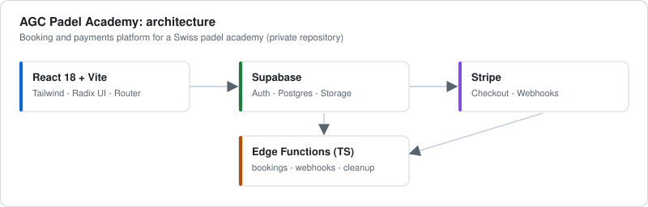
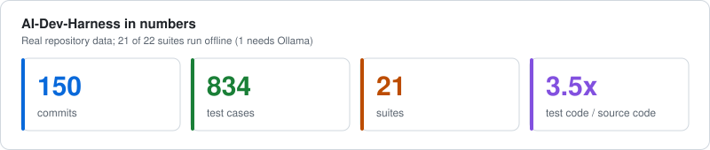
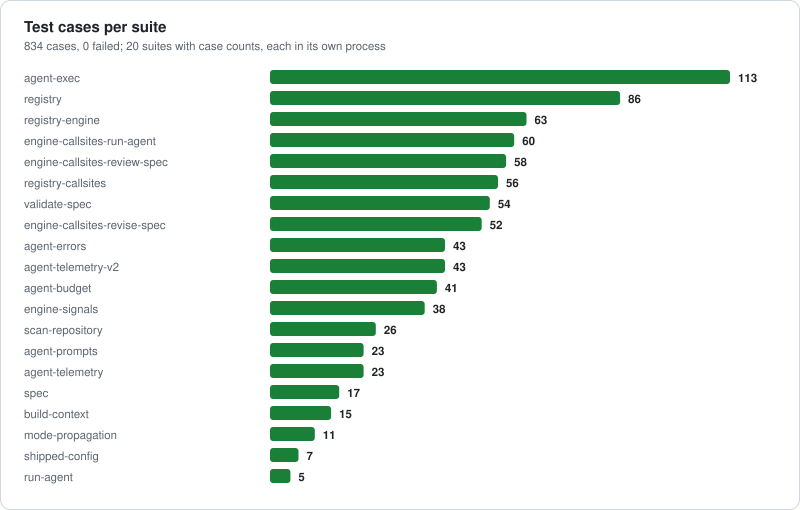
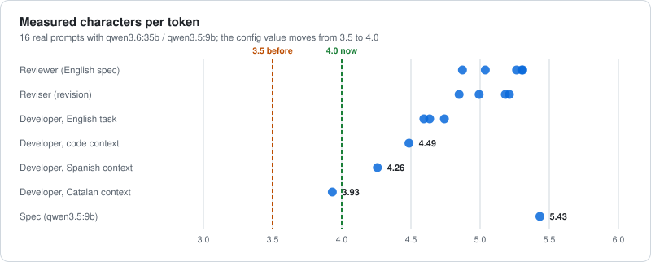
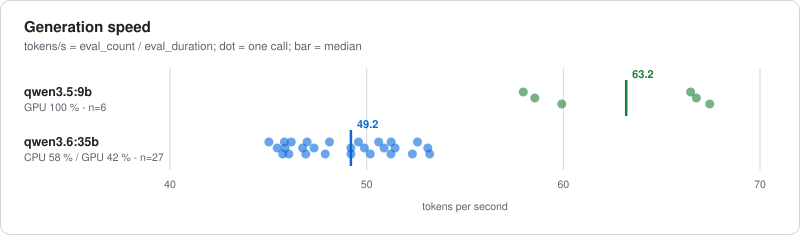
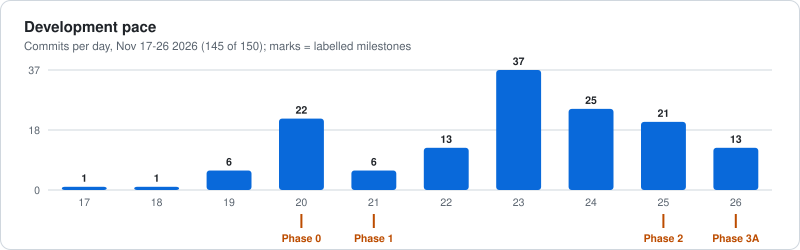
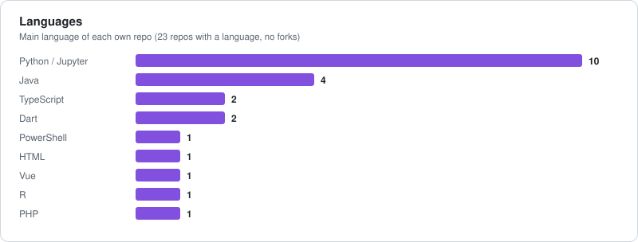

🌐 **English** · [Català](README.ca.md) · [Español](README.es.md)

# Hi, I'm Joan!

Full-stack developer and AI systems engineer from **Barcelona**, with professional experience since 2022 building web platforms and backend systems (Laravel, Vue, React, Go, AWS), and a specialisation in **AI & Big Data**. I'm especially interested in **AI applied to software development**: agents, local models, specification-driven development and, above all, **measuring** what really works.

> 🟢 **Open to work:** Full-Stack Developer roles · Barcelona (hybrid) or remote.

## 💼 Experience

| Period | Role | What I did |
|---|---|---|
| Dec 2024 – Oct 2026 | **Full-Stack Software Engineer**, NessunDorma Group | Web applications and REST APIs with PHP, Laravel, Vue.js, TypeScript and Go; led the migration of a local database application to the company ERP; built an internal real-time presentation automation platform (sync, PDF export, QR) and Go logging/automation tools. |
| Oct 2025 – today | **Freelance**: AGC Padel Academy | Booking and payments platform in production for a sports academy in Switzerland (React, Supabase, Stripe). |
| Oct 2023 – Mar 2024 | **Database Administrator**, Rehau S.A. | Maintenance of multinational databases (Spain / Portugal), user permissions and ERP data. |
| Feb 2022 – Aug 2023 | **Cross-Platform Developer**, Dokuos | Interactive software for digital totems (Node.js, PHP, Flutter, Dart, MySQL), remote software maintenance and backend/database management. |
| Feb – Jul 2019 | **IT Technician**, InfoConnexions | Installation and maintenance of systems, applications and hardware. |

**Education:** Specialisation course in AI & Big Data (2024–2025) · Higher Vocational Degree in Multiplatform Application Development, DAM (2020–2022) · Intermediate Vocational Degree in Microcomputer Systems & Networks (2017–2019)

**Certifications:** AWS Academy (Cloud Foundations, Cloud Architecting, Data Engineering) · Hugging Face Agents Course

## 🚀 In production: AGC Padel Academy

Full-stack **booking and payments platform** for [AGC Padel Academy](https://agcpadelacademy.com), a padel academy in Switzerland. Built **end to end as an MVP** (requirements, data model, frontend, backend, payments and deployment) and **running in production with real customers**.

> 🔒 The source code is private (client work). I'm happy to walk through the architecture and code on request.

**What it does**

- Public site: lessons, trips, tournaments, contact and legal terms, fully responsive
- Booking of lessons and activities, with user accounts (login and profile management)
- Online payments with **Stripe Checkout**, confirmed server-side through **webhooks**
- Booking rules in the data layer: cancellation windows, unpaid-booking cleanup and lesson credits
- Admin dashboard so trainers and staff manage sessions, availability and bookings
- Server logic in **Supabase Edge Functions** (TypeScript): bookings, webhooks, cleanup and contact form

**Stack:** React 18 · Vite · Tailwind CSS · Radix UI · React Router · Supabase (Auth, Postgres, Storage, Edge Functions) · Stripe

---

## 🔭 Featured project: [AI-Dev-Harness](https://github.com/Josafe/AI-Dev-Harness)

Multi-agent, multi-model environment for **specification-driven development (SDD)**. Local models (Qwen 3.5 / 3.6 with Ollama) handle simple tasks and Claude acts as orchestrator and reviewer depending on difficulty. All work follows a **spec → review → spec revision → implementation** cycle, with human approval at each step.

**What's inside**

| Piece | What it does |
|---|---|
| `scripts/specify.ps1`, `review-spec.ps1`, `revise-spec.ps1` | SDD workflow with specialised agents (spec, reviewer, reviser, developer) |
| `scripts/run-agent.ps1` | Runs any agent defined in `.ai/agents/` under a shared contract |
| `scripts/validate-spec.ps1` | Specification validator (structure and semantics) |
| `scripts/build-context.ps1`, `scan-repository.ps1` | Repository context for the agents, with a token budget |
| `scripts/lib/` | Shared engine: model/profile registry, Ollama calls, telemetry, retries |
| `.ai/config.json` | Single registry of models, profiles and limits (nothing hardcoded in the scripts) |

### 🧪 Tests

- 22 suites in **Windows PowerShell 5.1** (834 cases run offline, 0 failed), each in its own process, run by `scripts/test-all.ps1`.
- The runner **fails any suite that modifies the repository** (tripwire) and distinguishes `PASS`, `PASS WITH SKIPS` and `FAIL`; tests that need a real model only run with `-IncludeLive`.
- *Golden* prompt tests, Ollama *mocks* (local TCP fake host) and fixtures of valid and invalid specifications.
- Hand-made **mutation testing**: 20 mutants of the configuration, all caught by the tests (see the calibration report).

> Run of 2026-11-26 without Ollama: 21 of 22 suites executed (one needs a real model). The runner flagged 2 suites as FAIL only because of its *tripwire*: another worktree of the project was being modified during the run. All their test cases passed.

### 📊 Benchmarks and model validation

- `scripts/benchmark-models.ps1`: compares models over N repetitions and reports the **median** (tokens/s = `eval_count / eval_duration`).
- Real validation of `qwen3.5:9b` and `qwen3.6:35b`: the reviewer consistently rejects a bad spec (2 of 2 runs, ~52 s), and the sample limits are documented.
- **Context-budget calibration** with 16 real prompts: `charsPerToken` 3.5 → 4.0 and `reservedOutputTokens` 8192 → 6144, removing 7 of 10 false truncation warnings.

> Small samples on a single machine: signals, not definitive benchmarks. Catalan context (3.93 chars/token) falls below the configured 4.0, and the report documents it.

### 🗓️ Development pace

### 📚 Engineering documentation

Each phase is documented with independent audit reports, labelling what is *FACT*, *DECISION*, *ASSUMPTION* or *NOT VERIFIED*:

- [Modernization roadmap](https://github.com/Josafe/AI-Dev-Harness/blob/master/docs/roadmap/modernization-roadmap.md)
- [Model validation (round 2)](https://github.com/Josafe/AI-Dev-Harness/blob/master/docs/audits/2026-11-19-model-validation-2.md)
- [Phase 2 calibration](https://github.com/Josafe/AI-Dev-Harness/blob/master/docs/audits/2026-11-25-phase2-calibration.md)
- [Phase 2 final QA](https://github.com/Josafe/AI-Dev-Harness/blob/master/docs/audits/2026-11-26-phase2-final-qa.md)
- [Phase 3A gate review](https://github.com/Josafe/AI-Dev-Harness/blob/master/docs/audits/2026-11-26-phase3a-gate-review.md)

**Stack:** PowerShell 5.1 · Ollama · Qwen 3.5 / 3.6 · Claude · Git · Specification-Driven Development

---

## 🧰 Technologies and what I've done with them

Summary drawn from the code of my repositories (public and private). Private projects are described by technology only.

| Area | Technologies | What I've applied them to |
|---|---|---|
| **🤖 AI agents & LLMs** | Ollama · Qwen 3.5/3.6 · Claude · LangChain · LangGraph · MCP · Hugging Face | Specification-driven multi-agent harness with token budgeting, telemetry and model benchmarks; a multi-agent chatbot (Flask + LangGraph + Vue) that analyses and installs GitHub repositories; local MCP server experiments. |
| **🧠 Deep learning & NLP** | PyTorch · torchvision · Transformers · Pinecone | Own neural-network implementation, image classification (melanoma dataset), tabular models, LSTM, Transformers and GPT-2, and a RAG pipeline with a vector database. |
| **📈 Classical ML & RL** | scikit-learn · pandas · NumPy · seaborn · Gymnasium · R | Classification on Iris, wine and heart-disease datasets, maze search (A*), statistics scripts in R, and a DQN agent (replay buffer, epsilon-greedy) on CartPole written module by module. |
| **👁️ Vision & audio** | OpenCV · Ultralytics YOLO · Supervision · wav2vec | Object detection and supervision on video, and speech/vowel audio exploration. |
| **🎨 Frontend** | React 18 · Vite · Tailwind CSS · Radix UI · Vue 3 · Nuxt 3 · Angular · TypeScript | Production booking site in React; SSR portfolio ([josafe.dev](https://www.josafe.dev)) with typed content and Catalan/Spanish/English i18n; Vue 3 + TypeScript apps; Angular with RxJS, routing and Karma/Jasmine tests. |
| **⚙️ Backend & APIs** | Laravel 10/12/13 · Filament · PHP 8.3 · Supabase Edge Functions · Flask · Go · Sanctum | Admin panel with role-based access through policies and enums, with PHPUnit tests; serverless functions for bookings and Stripe webhooks; REST APIs in Flask and Laravel; Go services in private projects. |
| **🗄️ Data & payments** | PostgreSQL · SQLite · SQL · JDBC · Stripe | Relational schemas and migrations, Stripe Checkout confirmed by webhooks, and database access from Java. |
| **📱 Mobile & desktop** | Flutter/Dart · Kotlin · Java (Swing/AWT, concurrency, JUnit) · React Native | Flutter admin dashboard (provider, charts, calendar) over a PHP backend; Android apps in Kotlin; Java desktop applications; React Native + TypeScript technical test. |
| **🚢 DevOps & tooling** | Git/GitHub · Docker Compose · certbot · cron · AWS (S3, CloudFront, Route 53) · PowerShell | Phase tags and worktrees; containerised deployment with HTTPS and scheduled jobs in private projects; static hosting on AWS; PowerShell 5.1 automation and a custom test runner. |
| **🧪 Engineering practices** | Spec-driven development · golden and mutation testing · telemetry · audits · i18n | Specifications reviewed before code, offline test suites with a repository tripwire, measured calibration of model budgets and written audit reports. |

---

## 🗂️ Other projects

| Project | Description | Stack |
|---|---|---|
| [SME-Management-Pilot](https://github.com/Josafe/SME-Management-Pilot) | Modular management application for small and medium-sized service companies | PHP |
| [Portfolio](https://github.com/Josafe/Portfolio) | Personal portfolio with the projects I've built | Vue |
| [TFM-Sistema-Chatbot-Multiagent](https://github.com/Josafe/TFM-Sistema-Chatbot-Multiagent) | Lightweight retrained chatbot with a multi-agent system that analyses, clones and installs dependencies of GitHub repositories | Python |
| [AI](https://github.com/Josafe/AI) | All my progress in AI: classical ML, deep learning, NLP, imaging | Jupyter · Python |
| [AI_ReinforcedLearningModel](https://github.com/Josafe/AI_ReinforcedLearningModel) | Reinforcement learning model designed from code | Python |
| [AI_Ultralytics_Supervision](https://github.com/Josafe/AI_Ultralytics_Supervision) | AI for computer-vision supervision | Python |
| [TFG-CFGS-DAM](https://github.com/Josafe/TFG-CFGS-DAM) | Remote control of kiosks registered in the database | Dart |

## 🛠️ Technologies

## 📫 Contact

📍 Barcelona, Catalonia · 🌐 [josafe.dev](https://www.josafe.dev) · 🔗 [LinkedIn](https://www.linkedin.com/in/joan-sabater-ferr%C3%A9-2b4169115/) · 💼 GitHub: [@Josafe](https://github.com/Josafe)
